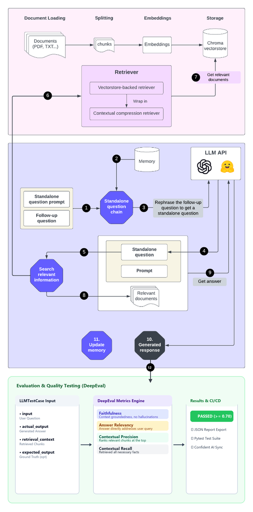

# RAG chatbot powered by 🔗 LangChain, OpenAI, Google Gemini & Hugging Face 🤗

> **RAG chatbot powered by LangChain, OpenAI, Google Gemini & Hugging Face.** Upload PDF, TXT, CSV, or DOCX documents and chat with your data. Streamlit UI with history-aware retrieval, 3 retriever types (vectorstore, contextual compression, Cohere rerank), streaming answers, and multi-language support.

<div align="center">
  
  <figcaption>RAG architecture with Langchain components.</figcaption>
</div>

## Project Overview <a name="overview"></a>

Although Large Language Models (LLMs) are powerful and capable of generating creative content, they can produce outdated or incorrect information as they are trained on static data. To overcome this limitation, Retrieval Augmented Generation (RAG) systems can be used to connect the LLM to external data and obtain more reliable answers.

The aim of this project is to build a RAG chatbot in Langchain powered by [OpenAI](https://platform.openai.com/overview), [Google Generative AI](https://ai.google.dev/?hl=en) and [Hugging Face](https://huggingface.co/) **APIs**. You can upload documents in txt, pdf, CSV, or docx formats and chat with your data. Relevant documents will be retrieved and sent to the LLM along with your follow-up questions for accurate answers.

Throughout this project, we examined each component of the RAG system from document loader to conversational retrieval chain. Additionally, we developed a user interface using [streamlit](https://streamlit.io/) application.

## Tech stack <a name="tech-stack"></a>

- **Python 3.12**
- **Streamlit** (UI)
- **LangChain 1.x** (`langchain-classic` for retriever classes, pure LCEL for the chain)
- **ChromaDB** (vector store)
- **DeepEval** (RAG evaluation & testing)

## Project structure <a name="structure"></a>

```
.
├── app.py                      # 🚀 Streamlit entry point (streamlit run app.py)
├── core/                       # RAG building blocks (framework-agnostic)
│   ├── config.py               # Providers, models, paths, constants
│   ├── document_loader.py      # Upload handling, loaders, text splitting
│   ├── embeddings.py           # OpenAI / Google / HuggingFace embeddings
│   ├── retrievers.py           # Vectorstore, compression, Cohere reranker
│   ├── llm.py                  # Chat model instantiation per provider
│   ├── chain.py                # Pure-LCEL RAG chain (history-aware + retrieval)
│   └── memory.py               # Chat history helpers (trimming, turns)
├── ui/
│   ├── sidebar.py              # Sidebar, tabs, vectorstore create/load
│   └── chat.py                 # Chat display, streaming, source documents
├── data/
│   ├── docs/                   # Sample documents and screenshots
│   └── vector_stores/          # Persisted Chroma vectorstores
└── requirements.txt
```

## Installation <a name="installation"></a>

This project requires Python 3.12. Run the following commands in the project directory:

```powershell
py -3.12 -m venv .venv
.\.venv\Scripts\activate
python -m pip install --upgrade pip
pip install -r requirements.txt
```

## Instructions <a name="instructions"></a>

1. Activate the virtual environment: `.\venv\Scripts\activate` on Windows.
2. Install the required dependencies `pip install -r requirements.txt`.
3. Start the app: `streamlit run app.py`.
4. In the sidebar, select the LLM provider (OpenAI, Google Generative AI or HuggingFace), choose an LLM (GPT-4o-mini, Gemini 2.5 Flash or Qwen2.5-7B-Instruct), adjust its parameters, and insert your API keys.
   - API keys can also be supplied through a `.env` file (see below).
5. Create a new vectorstore from your documents, or open a previously saved one.
6. Chat with your documents: ask questions and get 🤖 AI answers (streamed).

### Optional: `.env` file

Create a `.env` file in the project root to supply API keys without typing them
every time in the sidebar (sidebar inputs still take precedence):

```dotenv
OPENAI_API_KEY=sk-...
GOOGLE_API_KEY=AIza...
HUGGINGFACEHUB_API_TOKEN=hf_...
COHERE_API_KEY=...
```

## RAG architecture <a name="architecture"></a>

The modernized app uses the LangChain 1.x LCEL architecture instead of the deprecated
`ConversationalRetrievalChain` / memory classes:

- **History-aware retrieval** (`core/chain.py`): a prompt + LLM rephrase the
  follow-up question into a standalone question using the chat history, then the
  retriever fetches relevant documents.
- **Stuff question-answer chain**: the retrieved context (formatted by
  `format_documents`) and the chat history are sent to the LLM.
- **Memory** is managed by the application (a list of chat messages passed explicitly in
  the chain input), with an optional maximum number of conversation turns.
- **Streaming** responses via `st.write_stream`.
- **Retriever options** (`core/retrievers.py`): vectorstore-backed, contextual compression
  (`EmbeddingsRedundantFilter` + `EmbeddingsFilter` + `LongContextReorder`), and a
  Cohere reranker (`rerank-multilingual-v3.0`).
- **Evaluation & quality testing with DeepEval** (`tests/test_rag_eval.py` & `tests/test_rag_pytest.py`):
  evaluates the generated answers against retrieved documents using DeepEval metrics:
  - *Faithfulness* (groundedness, hallucination prevention)
  - *Answer Relevancy* (query alignment)
  - *Contextual Precision & Recall* (retriever quality)

```bash
# Run RAG evaluation with DeepEval
python -m tests.test_rag_eval
# OR pytest-style with CLI dashboard
deepeval test run tests/test_rag_pytest.py --verbose
```

## Blog post <a name="blog_post"></a>

I wrote a blog post about this project. You can find it [here](https://medium.com/@alaeddine.grine/rag-chatbot-powered-by-langchain-openai-google-generative-ai-and-hugging-face-apis-6a9b9d7d59db)